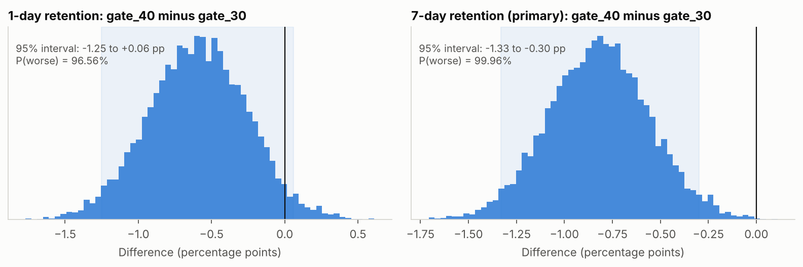

# A/B Test Readout: Moving the First Gate in a Mobile Game

**Product experiment analysis for 90,188 players: should the first "gate" in *Cookie Cats* move from level 30 to level 40? Covers metric design, data-quality checks, significance testing, power analysis and a ship / no-ship decision.**

`Experimentation` · `Python (pandas, SciPy)` · `Hypothesis testing` · `Bootstrap` · `Power analysis`

---

## Product question

In *Cookie Cats*, players hit a gate where they must wait or pay to continue. The team tested moving the first gate later (level 40), expecting players to stay engaged longer. **Should we ship it?**

## Experiment design

| | |
|---|---|
| Unit | Player, randomly assigned at install |
| Control / Treatment | `gate_30` (44,699 players) / `gate_40` (45,489 players) |
| **Primary metric** | 7-day retention, the best available proxy for long-term revenue |
| Secondary metric | 1-day retention |
| Guardrail | Rounds played in the first 14 days |
| Decision rule | Ship only if 7-day retention is not significantly worse (α = 0.05) and the guardrail holds |

## Data-quality checks (done before reading results)

- **Outlier:** one player logged 49,854 rounds in 14 days (bot or logging error), so it was removed.
- **Sample-ratio mismatch:** the split is 49.6% / 50.4%, chi-square p = 0.009. This is flagged in the readout, and engineering should confirm the assignment logging before the experiment is closed.
- **Pitfall avoided:** no segmenting by "players who reached level 30", because rounds played happen after assignment and would break randomisation.

## Results

| Metric | gate_30 | gate_40 | Difference | 95% CI | p-value |
|---|---|---|---|---|---|
| **7-day retention** | 19.02% | 18.20% | **−0.82 pp (−4.3%)** | −1.33 to −0.31 pp | **0.002** |
| 1-day retention | 44.82% | 44.23% | −0.59 pp | −1.24 to +0.06 pp | 0.074 |
| Rounds played (mean) | 51.3 | 51.3 | no change | – | 0.051 (Mann-Whitney) |



- In 10,000 bootstrap resamples, gate_40 had lower 7-day retention **99.96%** of the time.
- **Power:** with about 45K players per group, the minimum detectable 7-day effect was 0.74 pp. The observed 0.82 pp is above it, so the test had enough power for the primary metric. The 1-day effect would need about 111K players per group to detect reliably.

## Decision: do not ship. Keep the gate at level 30.

Moving the gate would mean **about 818 fewer players still active on day 7 for every 100,000 installs**. Play time does not change, so the loss is in players coming back, not in session length.

**Hypothesis for why:** a forced break at level 30 may make players come back fresher, while a gate at level 40 lets them burn out before the break.

**Next experiments**
1. Gate at level 25 (the opposite direction).
2. Gate *duration* instead of position.
3. Add revenue per user as a secondary metric.

The full stakeholder write-up is in [`reports/experiment_readout.md`](reports/experiment_readout.md).

## Repository structure

```
├── data/download_data.py
├── notebooks/01_ab_test_readout.ipynb
├── reports/
│   ├── experiment_readout.md      # one-page decision document
│   └── figures/
└── src/
    ├── ab_stats.py                # reusable: SRM check, z-test, bootstrap, MDE, sample size
    └── style.py
```

## How to run

```bash
pip install -r requirements.txt
python data/download_data.py
jupyter notebook notebooks/01_ab_test_readout.ipynb
```

`src/ab_stats.py` can be reused for any conversion-type experiment:

```python
from ab_stats import srm_test, two_proportion_test, mde_two_proportion
two_proportion_test(x_c=8501, n_c=44699, x_t=8279, n_t=45489)
```
